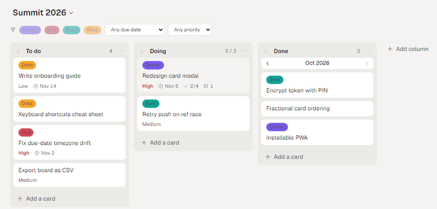
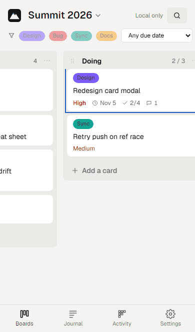

# Mountain of Tasks

A personal, local-first kanban board (Trello-style) that runs as a static PWA on GitHub Pages and syncs to a **private GitHub repo** you own. No server, no third-party backend: every change is an event committed to git, so you get full history, rollback and multi-device sync for free.

**Live app:** https://zenith4eva.github.io/MountainOfTasks/

<p align="center">
  
  
</p>

## Screenshots

**Web**

| Light | Dark |
| --- | --- |
|  |  |


**Phone**

<p>
  
  
  
</p>

## Features

- **Boards, columns, cards** with drag and drop, WIP limits, labels, due dates, priority, checklists, comments, markdown descriptions and cover images.
- **Done columns** group completed cards by month, with a month/year picker.
- **Attachments** (paste or drag-drop), stored in the data repo. Warns above 50 MB; refuses above 100 MB (GitHub's file limit).
- **Offline first.** Data lives in IndexedDB; the app works with no network and syncs when it comes back.
- **Sync** in auto mode (3 s debounce, generated commit messages like `[iPhone] move "Fix auth" → Doing`) or manual mode (pending badge, editable message).
- **History:** contribution heatmap, per-card timeline, a filterable journal of every event, and commit list with preview, restore and force reset.
- **`Ctrl+K` / `⌘K` palette** for cards, boards and commands.
- **Locked token:** your GitHub token is encrypted on-device with a 4-digit PIN (PBKDF2, 600k iterations, AES-GCM) or a biometric passkey (WebAuthn PRF: Face ID, Windows Hello).
- Light and dark themes, installable on phone and desktop.

## How it works

Data is event-sourced. The private data repo holds:

| Path | Contents |
| --- | --- |
| `events/<boardId>/<YYYY-MM>.jsonl` | Append-only events, the source of truth |
| `boards/<boardId>.json` | Derived snapshot, rewritten each sync |
| `meta.json` | Epoch, board index, labels, devices |
| `attachments/<cardId>/…` | Attachment files |

State is rebuilt by replaying events. Merging two devices is a union of events sorted by timestamp; the later edit to a field wins and both stay in history. Card order uses fractional indexes, so concurrent moves never collide. Deletes are soft. A restore or force reset bumps the `epoch`, and other devices drop their cache and refetch.

See [SPEC.md](SPEC.md) for the full design.

## Using it

1. Create a **private** repo for your data (default: `zenith4eva/mountain-of-tasks-data`; change `DATA_REPO` in [src/lib/github.ts](src/lib/github.ts) for your own).
2. Create a [fine-grained personal access token](https://github.com/settings/personal-access-tokens/new) limited to that repo with **Contents: Read and write**.
3. Open the app, paste the token, and set a PIN. The token never leaves your browser except in calls to `api.github.com`.

Five wrong PINs wipe the token from that device. Your repo is untouched.

## Development

Requires Node 24.

```bash
npm install
```

```bash
npm run dev
```

| Command | What it does |
| --- | --- |
| `npm run dev` | Vite dev server |
| `npm run build` | Type-check and build to `dist/` |
| `npm test` | Vitest unit tests (reducer, merge, fractional index, crypto) |
| `npm run e2e` | Playwright smoke test |

The sync integration test runs against a real throwaway repo and is skipped unless both variables are set:

```bash
SYNC_TEST_REPO=owner/name GH_TOKEN=$(gh auth token) npx vitest run tests/sync.int.test.ts
```

### Stack

Vite, React 19, TypeScript, Tailwind CSS 4, dnd-kit, Dexie (IndexedDB), TanStack Query, vite-plugin-pwa.

### Deploy

Pushing to `main` runs [.github/workflows/deploy.yml](.github/workflows/deploy.yml): tests, build, then publish to GitHub Pages. The Vite `base` is `/MountainOfTasks/`; change it in [vite.config.ts](vite.config.ts) if you fork under another name.
